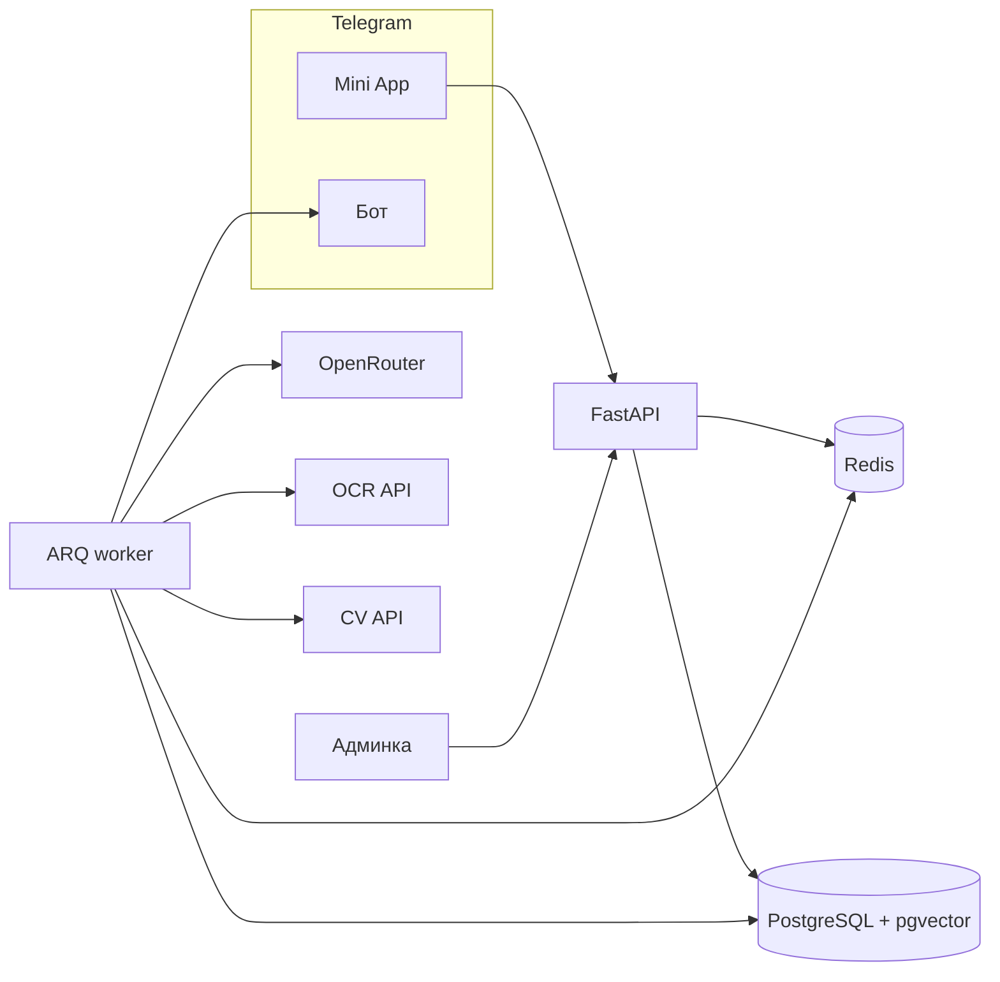

# Архитектура CHEIRO

Обзор текущего состояния (этап 1). Решения и их причины: [ADR](../adr/README.md).

## Сервисы

| Сервис | Роль |
|--------|------|
| `api` | REST: админка знаний, анализ ладони, проверка Telegram `initData` |
| `worker` | Тяжёлая работа в фоне: индексация книг, анализ ладони, отправка отчёта в бота |
| PostgreSQL + pgvector | Пользовательские задачи, источники, чанки и их векторы (одна БД) |
| Redis | Очередь ARQ и временные данные с TTL (загруженные файлы и фото) |
| Mini App | Интерфейс пользователя (`frontend/`) |
| Админка | Отдельное приложение (`admin/`, планируется; сейчас временный экран `/admin` во `frontend/`) |

## Потоки данных

### Индексация книги

1. Админ загружает EPUB/PDF → `POST /api/admin/sources`; запись `sources` (статус `pending`), дубликаты отсекаются по SHA-256.
2. Файл кладётся в Redis на 1 час, в очередь ставится `ingest_source_job`.
3. Воркер извлекает текст: EPUB; PDF с текстовым слоем; скан → OCR (интерфейс есть, провайдер подключается позже, без него загрузка завершается ошибкой источника).
4. Чанкинг (`RecursiveCharacterTextSplitter`, размер и перекрытие из настроек) → эмбеддинги через OpenRouter → `document_chunks`.
5. Статус источника: `ready` или `failed` с текстом ошибки.

### Анализ ладони

1. Mini App отправляет фото (base64) → `POST /api/analysis` с подписью Telegram `initData`.
2. Создаётся `analysis_jobs`; **фото кладётся только в Redis на 30 минут** и удаляется воркером сразу после чтения. На диск, в БД и в логи фото не попадает.
3. Воркер: признаки ладони (адаптер CV, пока заглушка) → поиск по базе знаний (top-k по косинусной близости) → генерация отчёта LLM с системным промптом → тизер.
4. Статус задачи обновляется (`recognizing` → `searching` → `generating` → `done`); Mini App опрашивает `GET /api/analysis/{id}`.
5. Mini App получает **только тизер**. Полный отчёт отправляется ботом пользователю в личные сообщения.

## Модель данных

- `sources`: книга (название, автор, язык, файл, хэш, статус, ошибка).
- `document_chunks`: фрагмент текста, номер, вектор (`Vector(1536)`), ссылка на источник.
- `analysis_jobs`: Telegram-пользователь, статус, признаки, тизер, полный отчёт, ошибка.

Таблицы пока создаются при старте (`create_all`); миграции Alembic запланированы до первого продакшена.

## Безопасность и приватность

- Пользователь определяется подписью Telegram `initData` (HMAC); чужие задачи недоступны (404).
- Админские маршруты защищены токеном `X-Admin-Token` (сравнение в постоянное время). Вне `DEBUG` приложение не стартует с небезопасным токеном или без токена бота.
- CORS ограничен адресом Mini App.
- Секреты только в переменных окружения.

## Ограничения текущей версии

- CV-детекция линий — заглушка (подрядчик не выбран); интерпретация опирается на RAG.
- OCR — интерфейс без подключённого провайдера.
- Тизер выделяется из ответа эвристикой (первые строки); будет заменён структурным ответом в Prompt Studio.
- Prompt Studio и выбор модели из админки — запланированы; сейчас промпт в файле, модель в переменных окружения.
